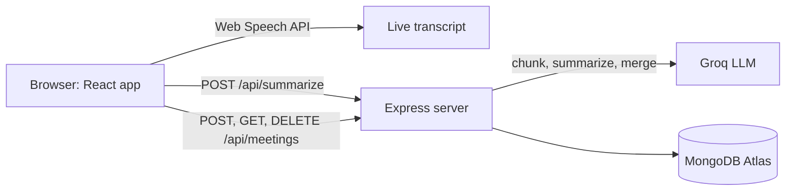

# AI-Meeting-Summarizer

A bilingual (English and Hindi) meeting assistant. Record a meeting, watch the transcript appear live, and get an AI-written summary with a clear list of who needs to do what.

**Live demo:** https://ai-meeting-summarizer-plum.vercel.app

> The backend runs on a free hosting plan that sleeps when idle. The first request after a quiet period can take up to a minute. Click **Try sample meeting** to see the full flow without a microphone.


## Features

- **Live transcript** while you speak, in English or Hindi, using the browser Web Speech API.
- **AI summary and action items** (owner and task) generated from the transcript, in the language you choose.
- **Long meetings supported.** Long transcripts are split into chunks, summarized one by one, then merged into a single summary.
- **Meeting history.** Save a meeting, browse the list, open the full detail page, and delete.
- **Try sample meeting.** One click runs the whole AI flow with a built-in transcript, so it works even without a microphone or in an unsupported browser.
- **Dark mode**, responsive layout, and accessible controls (labels, live regions, keyboard focus).
- **Resilient UI.** Loading skeletons, empty states, retry buttons, an error boundary, and clear messages when the microphone or speech service is unavailable.

| Meetings list                                  | Hindi summary                               |
| ---------------------------------------------- | ------------------------------------------- |
|  |  |

## Tech stack

**Frontend:** React, TypeScript, Vite, Tailwind CSS, React Router, TanStack Query, lucide-react

**Backend:** Node.js, Express, MongoDB (Atlas) with Mongoose

**AI:** Groq API (`openai/gpt-oss-120b`) for summaries

**Testing:** Vitest, React Testing Library

**Hosting:** Vercel (frontend), Render (backend), MongoDB Atlas (database)

## Architecture



**How a summary is made**

1. The browser sends the transcript and the chosen language to the server.
2. The server splits the text at sentence boundaries into chunks (smaller chunks for Hindi, because Devanagari uses more tokens per character).
3. Each chunk is summarized one at a time, to stay inside the free API token limit. On a rate limit (HTTP 429) the server waits and retries.
4. If there was more than one chunk, the partial summaries are merged into one final summary.
5. The model reply is parsed and validated before it is returned, so the frontend never receives malformed data.

## Engineering decisions

- **Hooks hold the logic, components only render.** `useAudioRecorder`, `useSpeechRecognition`, `useSummarize` and the TanStack Query hooks keep the UI simple and testable.
- **Server state and client state are separate.** Recording status lives in hooks. The meetings list is server state, handled by TanStack Query with cache invalidation after save and delete.
- **AI output is treated as untrusted input.** The prompt asks for strict JSON, and the server validates the shape before use.
- **Secrets stay on the server.** The Groq key and database string live in environment variables on the backend, never in the frontend bundle.
- **Abuse protection.** A strict rate limit on the AI route, a general rate limit on the API, `helmet` security headers, input validation, a size cap on transcripts, and a CORS allowlist read from the environment.
- **Performance.** Route-level code splitting with `lazy` and `Suspense`, and a memoized transcript list so frequent speech updates do not re-render everything.
- **Android fix.** Android Chrome can mark every growing partial result as final. The app merges those into a single line, so the transcript and the summary are not full of duplicates.

## API

| Method | Endpoint            | Purpose                                    |
| ------ | ------------------- | ------------------------------------------ |
| GET    | `/api/health`       | Health check                               |
| POST   | `/api/summarize`    | Summary and action items from a transcript |
| POST   | `/api/meetings`     | Save a meeting                             |
| GET    | `/api/meetings`     | List meetings, newest first                |
| GET    | `/api/meetings/:id` | Get one meeting with full details          |
| DELETE | `/api/meetings/:id` | Delete a meeting                           |

## Run it locally

You need Node.js 20 or newer, a free [MongoDB Atlas](https://www.mongodb.com/atlas) cluster, and a free [Groq](https://console.groq.com) API key.

```bash
git clone https://github.com/YOUR_USERNAME/meetmind-ai.git
cd meetmind-ai
```

**Server**

```bash
cd server
npm install
```

Create `server/.env`:

```
PORT=5000
GROQ_API_KEY=your_groq_key
MONGODB_URI=your_mongodb_connection_string
CLIENT_ORIGIN=http://localhost:5173
SUMMARY_LIMIT=100
```

```bash
npm run dev
```

**Client** (in a second terminal)

```bash
cd client
npm install
npm run dev
```

Open http://localhost:5173 in Google Chrome. Optionally create `client/.env` with `VITE_API_URL=http://localhost:5000`; this is the default.

**Tests**

```bash
cd client && npm test -- --run
cd server && npm test -- --run
```

## Project structure

```
client/src/
  features/meeting/
    api/          API calls
    components/   RecorderPanel, SummaryCard, TranscriptLines
    hooks/        useAudioRecorder, useSpeechRecognition, useSummarize, useMeetings
    pages/        MeetingsPage, MeetingDetailPage
  shared/         Button, Card, ErrorBoundary, EmptyState, Skeleton
server/src/
  index.ts        routes, security middleware
  summarize.ts    chunking, retry, prompts, validation
  models/         Meeting schema
  db.ts           database connection
```

## Limitations and next steps

- **Live transcript depends on the browser.** It uses the Web Speech API, which works best in Google Chrome. Some browsers (for example Brave) block it. The audio for recognition is processed by the browser's speech service. Next step: server-side speech-to-text (Whisper) as a fallback that works in every browser.
- **Transcript quality.** Speech recognition can mishear words and names. Next step: let users edit the transcript before summarizing.
- **No authentication yet.** All meetings are shared. Next step: JWT login with per-user meetings.
- **Free hosting.** The backend sleeps when idle, so the first request can be slow. The AI provider's free tier also has rate limits, which the server handles with retry and a request limit.
- **Rate limiter is in memory.** It does not share state across multiple servers. Next step: a Redis-backed limiter.
- **Hindi summaries** are a little less polished than English ones.
- **Mobile audio file.** On phones the app skips saving an audio file so the speech recognizer gets the microphone. The transcript and summary still work.
